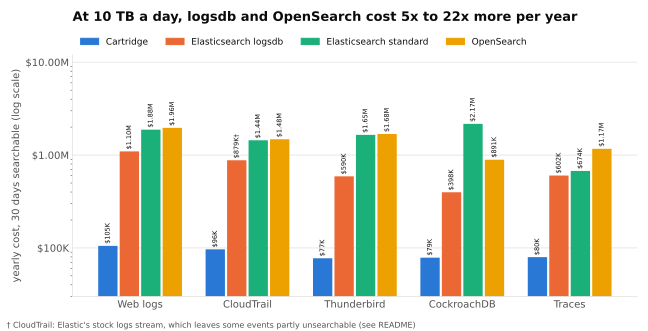
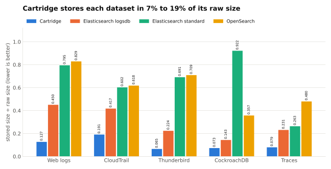
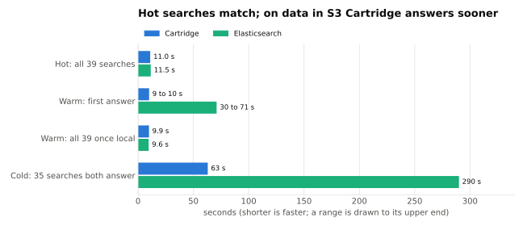

# Cartridge benchmarks

- Cartridge stores five public log datasets in 7% to 19% of their raw size, which is 1.8x to 12.6x smaller than Elasticsearch (logsdb and standard).
- On the web-log benchmark, hot searches take the same time as Elasticsearch; with the data in S3, Cartridge answers its first search in 9 to 10 s against 30 to 71 s.
- At 10 TB of logs a day with 30 days searchable, that is $105,283 a year on web logs against $1,095,187 to $1,961,039 for the others.



Everything here uses public datasets and runs on AWS. Every system is run in its documented default setup (mappings and templates are in the repo), each number is one measurement
that was not re-run to pick a better one, and the caveats sit under the numbers. Each section ends with the script that produced the numbers and the stored result they came from.
The charts are drawn from the stored results by [`plots/make_plots.py`](plots/make_plots.py).

## Storage



Stored size in bytes (one shard, no replica, force-merged to one segment, primary store bytes). Raw sizes: web logs 23.5 GB, Thunderbird 10.7 GB, CockroachDB 10.5 GB, CloudTrail 2.4 GB, traces 19.7 GB.

| Dataset | Cartridge | Elasticsearch logsdb | Elasticsearch standard | OpenSearch |
|---|---:|---:|---:|---:|
| Web logs | 2,978,277,499 | 10,567,779,983 | 18,656,019,625 to 22,547,013,768 | 19,456,920,952 |
| Thunderbird | 701,303,359 | 2,400,695,754 | 7,419,489,100 | 7,614,836,272 |
| CockroachDB | 766,850,694 | 1,506,138,614 | 9,682,259,352 | 3,751,271,057 |
| CloudTrail | 456,060,724 | 841,790,533 † | 1,438,882,886 | 1,476,093,976 |
| Traces | 1,568,758,212 | 4,560,877,302 | 5,200,242,650 | 9,471,101,499 |

Cartridge is 10.6x smaller than Elasticsearch standard on Thunderbird and 12.6x on CockroachDB, but only 3.3x on traces, the smallest gap of the five.
Against logsdb the gaps are 3.5x (web logs), 3.4x, 2.0x, 1.8x (CloudTrail) and 2.9x (traces).

- Ratios are stored bytes divided by Cartridge's bytes at level 2, the default press. Thunderbird, CockroachDB, CloudTrail and traces also have a level 1 press, which is smaller; see the dataset READMEs.
- Web logs: Cartridge is 2,118,597,954 B cartridge plus 859,679,545 B field index (0.127x raw), default press flags. Elasticsearch standard was measured twice by the same method (cause of the gap not known); Cartridge is 6.3x to 7.6x smaller than it, and 6.5x smaller than OpenSearch.
- Elasticsearch logsdb uses the free licence. On traces the logsdb column is the stock trace stream.
- † CloudTrail: the logsdb column is Elastic's stock logs data stream, which leaves 20.9% of events partly unsearchable. The variant with four flattened fields, which is fully searchable, is 996,991,992 B (0.417x raw, 2.2x Cartridge) and $1,023,033 a year (10.6x). Elasticsearch standard uses the same four flattened fields.
- CockroachDB: Elasticsearch used dynamic mapping where OpenSearch used an explicit timestamp mapping.

Script → Result: [`speed/http_logs/10-size.sh`](speed/http_logs/10-size.sh) → [`results/speed/http_logs/size/`](results/speed/http_logs/size) (web logs; Cartridge from [`results/speed/http_logs/verify/`](results/speed/http_logs/verify)) ·
[`storage/thunderbird/run.sh`](storage/thunderbird/run.sh) → [`results/storage/thunderbird-es955-cartridge.md`](results/storage/thunderbird-es955-cartridge.md) ·
[`storage/cockroachdb/run.sh`](storage/cockroachdb/run.sh) → [`results/storage/cockroachdb-es955-cartridge.md`](results/storage/cockroachdb-es955-cartridge.md) ·
[`storage/cloudtrail/run.sh`](storage/cloudtrail/run.sh) → [`results/storage/cloudtrail-es955-cartridge.md`](results/storage/cloudtrail-es955-cartridge.md) ·
[`storage/traces/run.sh`](storage/traces/run.sh) → [`results/storage/traces-es955-cartridge.md`](results/storage/traces-es955-cartridge.md)

## Speed



Web logs, seconds for the whole set of searches (39 searches; the cold row counts the 35 that both systems answer).

| Tier | Cartridge | Elasticsearch |
|---|---:|---:|
| Hot (data on local disk) | 11.0 | 11.5 |
| Warm, first answer (data in S3, fresh server) | 9 to 10 | 30 to 71 |
| Warm, all 39 once local | 9.9 | 9.6 |
| Cold (data stays in S3) | 63 | 290 |

- Cartridge's hot 11.0 s uses its field index; without it the run takes 16.3 s.
- Elasticsearch's warm first answer is 30 to 47 s with a fully mounted searchable snapshot and 64 to 71 s with a restore to local disk. Its cold run uses the frozen tier.
- Cold Cartridge searches on some chains do not finish in 60 s. A fix for Cartridge's cold time is in progress, so the 63 s will change.

Script → Result: [`speed/http_logs/20-speed.sh`](speed/http_logs/20-speed.sh) (`hot-cart`, `hot-es`, `warm-cart`, `warm-es-fullcopy`, `warm-es-restore`, `cold-cart`, `cold-es`) →
[`results/speed/http_logs/speed/`](results/speed/http_logs/speed) (`hot-cart-field-index.log`, `hot-es.log`, `hot-cart-no-field-index.log`, `warm-cart-field-index.log`, `warm-es-fullcopy.log`, `warm-es-restore.log`, `cold-cart.log`, `cold-es-frozen.log`)

## Correctness

| Searches matching the exact answer in the hot run | Cartridge | Elasticsearch |
|---|---:|---:|
| Of 39 | 39 | 34 |

48 of 48 searches match answers computed independently from the raw text (run on 2026-10-26). Elasticsearch's five misses are top-N searches at its default setting.

Script → Result: [`speed/http_logs/reference.py`](speed/http_logs/reference.py), [`verify_cart.py`](speed/http_logs/verify_cart.py) → [`results/speed/http_logs/verify/`](results/speed/http_logs/verify)

## Cost

Yearly cost at 10 TB a day, 30 days searchable. This is model output at AWS us-east-2 list prices (October 2026), not an invoice. It prices the sizes measured above; the chart at the top shows all five datasets.

| Web logs | Cartridge | Elasticsearch logsdb | Elasticsearch standard | OpenSearch |
|---|---:|---:|---:|---:|
| Dollars a year | 105,283 | 1,095,187 | 1,876,859 | 1,961,039 |
| Times Cartridge | 1.0 | 10.4 | 17.8 | 18.6 |

Across the other four datasets Elasticsearch standard costs 8.5x to 27.6x as much as Cartridge and logsdb 5.1x to 9.1x.

- Ratios divide by the larger of the two Cartridge sizes per dataset, so they are the conservative ones; the full table also has the smaller size.
- Cost of the CloudTrail logsdb bar is the stock logs stream, $878,724 a year, marked † in the chart; the flattened variant is $1,023,033 (10.6x).
- The cost model prices Cartridge's web logs at the verified default press, 2,118,597,954 B of cartridge plus 859,679,545 B of field index (2,978,277,499 B in total).
- logsdb uses the free licence. Elasticsearch's Enterprise-licence setups (synthetic source, frozen tier) are priced only where the table says so.

Script → Result: [`cost/`](cost) (`cd cost && uv run cost-matrix`) → [`results/cost/matrix-10tb-30d.md`](results/cost/matrix-10tb-30d.md), [`matrix-10tb-30d.json`](results/cost/matrix-10tb-30d.json)

## Reproduced

To check that the public scripts alone give the published numbers, `storage/cloudtrail/run.sh` was run unmodified from a clean `git archive` of this repository (commit `0207790`)
on a fresh c7i.4xlarge on 2026-10-26.

| System | Committed bytes | Reproduced bytes | Difference |
|---|---:|---:|---:|
| Elasticsearch standard (flattened fields) | 1,438,882,886 | 1,439,455,684 | +0.040% |
| Elasticsearch logsdb (flattened fields) | 996,991,992 | 996,928,985 | -0.006% |
| Elasticsearch stock logs data stream | 841,790,533 | 841,798,533 | +0.001% |
| OpenSearch 3.9.0 default | 1,476,093,976 | 1,475,979,582 | -0.008% |
| Cartridge level 2 | 456,060,724 | 456,060,706 | -18 B |
| Cartridge level 1 | 389,109,483 | 389,109,465 | -18 B |

- Cartridge differs by 18 bytes at both levels because the reproduction used a newer build (cartpress 0.17.1, build `513456b75`) than the committed run (build `6bbd7038c`).
- Elasticsearch and OpenSearch sizes vary slightly between runs.
- The log's last line says FAILED because the checking script then required byte-identical Cartridge sizes across builds and compared OpenSearch with the wrong reference figure. Both were fixed afterwards and the table uses the corrected comparison.

Script → Result: [`storage/cloudtrail/run.sh`](storage/cloudtrail/run.sh) → [`results/repro/cloudtrail-c7i-4xlarge-2026-10-26.log`](results/repro/cloudtrail-c7i-4xlarge-2026-10-26.log)

## Layout

| Directory | What it holds |
|---|---|
| [`storage/`](storage) | One directory per dataset (`thunderbird`, `cockroachdb`, `cloudtrail`, `traces`): a `run.sh` with the commands that produce each size, the loaders it calls, the OpenSearch mapping, and a README. [`storage/README.md`](storage/README.md) is the index. |
| [`speed/`](speed) | The web-log benchmark ([`speed/http_logs`](speed/http_logs)): data download, size passes, the speed tiers, the 39 searches with their expected answers, and the correctness check. |
| [`cost/`](cost) | The cost model: prices, sizing rules and measured coefficients as JSON files with sources, and one arithmetic function per system. |
| [`results/`](results) | The logs and tables the scripts produced. Every number in the READMEs is in a file here. |
| [`plots/`](plots) | `make_plots.py` and the SVG charts it draws from `results/`. |
| [`lib/`](lib), `speed/lib/` | Shared helpers: starting Docker containers, bulk-loading, download and checksum helpers, the force-merge and settle measurement, the results table, the search runner. The commands that decide a number stay in the `run.sh` and `20-speed.sh` files. |

## How to run

You need an AWS account and a Linux machine with Docker (run through `sudo`), `curl`, `jq`, `python3` and `uv`. The scripts start containers, download tens of gigabytes and take hours;
they are not meant for a laptop. We used one r7i.4xlarge (16 vCPU, 128 GB) on demand for loading, pressing and the size measurements, and a c7i.4xlarge (16 vCPU, 32 GiB, gp3 at 16,000 IOPS)
for the web-log speed runs. The speed runs also need an S3 bucket (`export BUCKET=...`) and an instance role that can read and write it. Per-dataset needs are in each script's header.

| Dataset | Source | Fetched by |
|---|---|---|
| Web logs (1998 World Cup) | Rally track `http_logs`, `https://rally-tracks.elastic.co/http_logs` | `speed/http_logs/00-data.sh` |
| Thunderbird syslog | Loghub, Zenodo record 8196385 (CC-BY 4.0) | `storage/thunderbird/run.sh` |
| CockroachDB JSON logs | Zenodo record 10516387 (CC-BY 4.0) | `storage/cockroachdb/run.sh` |
| CloudTrail logs | flaws.cloud, `summitroute.com/downloads/flaws_cloudtrail_logs.tar` | `storage/cloudtrail/run.sh` |
| Microservice traces | Alibaba cluster-trace-microservices-v2022, call-graph chunks 0 to 3 | `storage/traces/run.sh` |

```sh
# storage: one dataset at a time
storage/thunderbird/run.sh     # likewise cockroachdb, cloudtrail, traces

# web logs
export BUCKET=<your-s3-bucket>
speed/http_logs/00-data.sh                # download, check sizes, line count and three reference counts
speed/http_logs/10-size.sh all            # stored sizes
speed/http_logs/20-speed.sh setup         # load Elasticsearch, snapshot, press Cartridge, upload
speed/http_logs/20-speed.sh all           # hot, warm and cold arms
# correctness check: see speed/http_logs/README.md ("How exactness was checked")

# cost: needs only the stored results
cd cost && uv run cost-matrix

# charts: redraw plots/*.svg from results/
uv run --script plots/make_plots.py
```

Cartridge: `curl -sSf https://cartridge.app/install | sh` installs `cartridge` and `cartpress` (or download them from [cartridge.app](https://cartridge.app)). A press uses your account's pressing credit (the first 25 GB are free) and asks you to confirm.
The stored runs used the same release built without the licence check, so they drew no pressing credit; a press with the public command can give slightly different sizes (see [`speed/http_logs/README.md`](speed/http_logs/README.md)).

## Fairness

- **Defaults for every system.** Elasticsearch 9.5.x in Docker, one node, free licence, security off. Standard mode is `index.mode=standard` with dynamic mapping apart from the fields named in each README; logsdb is the stock data stream or template.
  OpenSearch 3.9.0 has every storage setting at its default. Mappings and templates: [`speed/http_logs/es-index-template.json`](speed/http_logs/es-index-template.json),
  [`storage/thunderbird/opensearch-mapping.json`](storage/thunderbird/opensearch-mapping.json), [`storage/cockroachdb/opensearch-mapping.json`](storage/cockroachdb/opensearch-mapping.json),
  [`storage/cloudtrail/opensearch-mapping.json`](storage/cloudtrail/opensearch-mapping.json), [`storage/traces/opensearch-mapping.json`](storage/traces/opensearch-mapping.json).
- **One measurement per number.** Each size, time and cost comes from one stored run. Nothing was repeated to find a better value; where a first pass was thrown away, the README says why.
- **Sizes are measured the same way.** One shard, no replica, force-merge to one segment, then primary store bytes. For OpenSearch the measurement also flushes and waits for the size to settle.
- **Same limits for speed runs.** Both systems run in Docker with 4 CPUs and 16 GB, the same instance type, volume and bucket. Result caches are off, the file cache is dropped and the server restarted before each chain, and each search is capped at 60 s.
- **Where Cartridge does not win.** Elasticsearch loads the traces data faster than Cartridge presses it, and the size gap on traces is the smallest. The cold row only counts the 35 searches both systems answer.
- **Details.** [`speed/http_logs/README.md`](speed/http_logs/README.md), [`storage/README.md`](storage/README.md), [`storage/thunderbird`](storage/thunderbird/README.md), [`storage/cockroachdb`](storage/cockroachdb/README.md),
  [`storage/cloudtrail`](storage/cloudtrail/README.md), [`storage/traces`](storage/traces/README.md), [`cost/README.md`](cost/README.md).
